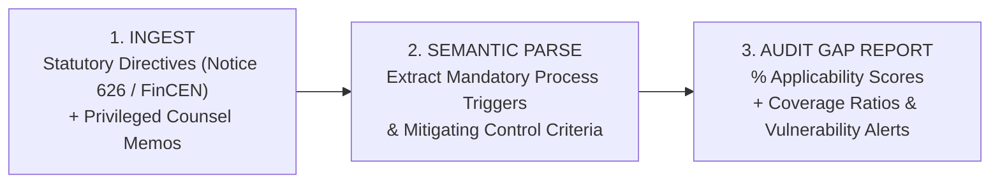

# GRC NEXUS — AI-Native Regulatory Obligation & Governance Platform 🛡️

[](https://adrian-d-lin.github.io/GRC-Nexus-Landing/)
[](https://adrian-d-lin.github.io/GRC-Nexus-Landing/)
[](https://adrian-d-lin.github.io/GRC-Nexus-Landing/#wedge)

> **Turn 60-Page Regulatory Directives into Instant Process & Control Mappings.**  
> Deterministic, on-premise AI compliance architecture engineered for Singapore financial institutions, payment processors, and boutique audit consultancies.

---

## 🚀 Quick Launch Links

| Destination | Link |
| :--- | :--- |
| 🌐 **Official Landing Page** | [**https://adrian-d-lin.github.io/GRC-Nexus-Landing/**](https://adrian-d-lin.github.io/GRC-Nexus-Landing/) |
| ⚡ **Interactive AML Parser Cockpit** | [**Jump directly to Live Demo ⚡**](https://adrian-d-lin.github.io/GRC-Nexus-Landing/#wedge) |
| 🗺️ **22-Module Architecture Roadmap** | [**View 22-Module Architecture**](https://adrian-d-lin.github.io/GRC-Nexus-Landing/#architecture) |
| 📦 **Core Prototype Repository** | [`Adrian-D-Lin/GRC` (branch: `cybrdeck`)](https://github.com/Adrian-D-Lin/GRC/tree/cybrdeck) |

---

## ⚡ The Executive Summary Card (Whiteboard Output)

Instead of vague generic compliance chatbots, **GRC Nexus** executes a mathematically bounded evaluation across pre-mapped payment rails:

```
┌────────────────────────────────────────────────────────────────────────┐
│  ⚡ EXECUTIVE SYNTHESIS REPORT (STATUTORY NOTICE 626 / FINCEN EVALUATION)    │
├────────────────────────────────────────────────────────────────────────┤
│  "These processes are 92% LIKELY to be subject to this regulation.    │
│   3 / 4 of exposed processes already have associated controls."       │
│                                                                        │
│  • P-101: VISA Settlement Network           │ 94% Likelihood (Covered) │
│  • P-102: PayPal Merchant Payouts           │ 88% Likelihood (GAP)     │
│  • P-103: OCBC FAST Real-Time Clearing      │ 76% Likelihood (Covered) │
│  • P-104: Corporate Internal Payroll        │ 18% Likelihood (Low)     │
│                                                                        │
│  ⚠️ IMMEDIATE VULNERABILITY DETECTED:                                  │
│  Process P-102 lacks mandatory automated PEP screening prior to        │
│  credit release.                                                       │
└────────────────────────────────────────────────────────────────────────┘
```

---

## 🧩 The 3-Step Deterministic Workflow



1. **Step 1 — Dual Document Ingestion**:
   - Ingest raw statutory directives (e.g., Notice 626, FinCEN 31 CFR 1010.410) alongside internal legal counsel memos. The directive supplies the regulatory obligation; the memo provides internal institutional context.
2. **Step 2 — Semantic Criteria Extraction**:
   - The engine deterministically isolates criteria that make a process in-scope (*cross-border settlement, wire transfer, foreign currency, stored value*) and criteria that describe a mitigating control (*sanctions screening, velocity thresholds, PEP verification*).
3. **Step 3 — Audit Gap & Coverage Report**:
   - Overlays the extracted criteria directly against the institution's Process Universe to generate audit-ready applicability percentages and highlight unmitigated payment rails.

---

## 🏛️ The 22-Module Architecture Map

GRC Nexus is designed with a 4-tier modular architecture. The core launch architecture is focused on **CORE-02: Regulatory Obligations**, while the broader platform scales across 22 interconnected modules:

| Tier | Module Range | Key Capabilities |
| :--- | :--- | :--- |
| **Core Platform Services** | `CPS-01` to `CPS-05` | RBAC & access control, immutable audit trail ledger, agent session memory, data sanitization, cross-module relational mapping. |
| **Core Modules** | `CORE-01` to `CORE-05` | Process Universe (L1-L3 hierarchies), **Regulatory Obligations (Active Engine)**, Governance Document Library, Product Catalog, Third-Party Registry. |
| **Orbit Operational** | `ORB-01` to `ORB-08` | Control Assessment (CD & OE), Risk Measurement & Invalidation, Audit & Assurance, Compliance Monitoring, Financial Crime Compliance (FCC). |
| **Halo Reporting** | `HALO-01` to `HALO-04` | Scenario Analysis & Stress Testing, Statutory Regulatory Returns Reporting, Executive Risk Cockpits, Board Risk Committee Packs. |

---

## 💼 Consulting Partner Distribution (Go-to-Market Strategy)

Rather than fighting 18-month bank enterprise procurement cycles, GRC Nexus is positioned as a **throughput multiplier for boutique GRC consultancies and 2nd-line risk advisors**:
- Enables advisory firms to run client gap analyses in **20 minutes** instead of 6 hours.
- Operates locally on-premise with zero third-party cloud data leaks (satisfying strict banking secrecy and PDPA requirements).
- Directly targets the **~350 Singapore-licensed financial institutions** in Singapore.

---

## 💻 Local Development

### Static GitHub Pages Mode (Zero Build Step)
The repository root contains clean static assets that run immediately in any browser:
```bash
# Serve locally with any static web server:
npx serve .
# or python
python -m http.server 8000
```

### Full React / TanStack Source Project
The repository also includes the complete interactive TypeScript source:
```bash
# Install dependencies
npm install

# Start development server
npm run dev

# Run test suite
npm run test
```

## 📄 Corporate Entity
- **Entity**: Adrish Holdings Pte Ltd (`UEN: 202631108D`)
- **Product**: GRC Nexus Enterprise Platform
- **License**: Proprietary / Commercial

